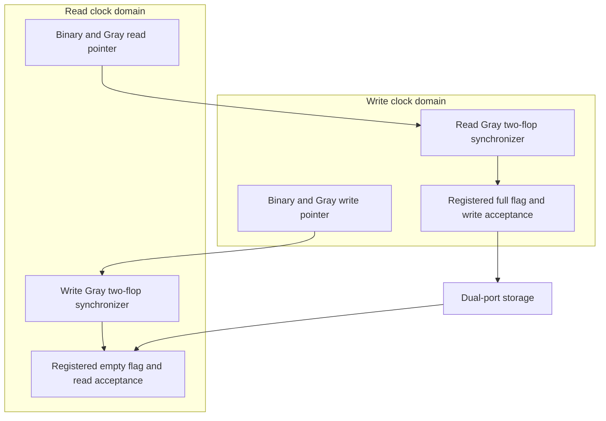

# Async FIFO formal verification

Reproducible digital safety and data-integrity checks for a Gray-pointer dual-clock FIFO, plus a Real Digital Boolean FPGA demonstration. This source tree deliberately excludes raw solver runs, transcripts, caches, local research manuscripts and generated FPGA images.

## Verified scope

The recorded evidence through 30 October 2026 supports these **configuration-specific** conclusions:

| Property suite | Address width / data width | Recorded result |
|---|---|---|
| Six reset/history-qualified Phase 1 assertions | A=2-5 / B=8 | Independent-clock ABC PDR PASS; single-clock Z3 induction PASS |
| Original sixteen-assertion integrity checker | A=2 and A=3 / B=8 | PDR PASS; finite tagged-item selection and shared startup reset |
| Arbitrary-time selected-item observer, twenty assertions total | A=2 / B=8 | Independent-clock PDR PASS; identical-input replay PASS |
| Arbitrary-time observer at A=3 | B=8, 300-second attempt | TIMEOUT |
| Original integrity at A=4 and A=5 | B=8, 240 seconds each | TIMEOUT |
| Reset synchronizer reference | Five digital assertions | PDR PASS; reference only, not a complete reset/flush protocol |
| Boolean FPGA demonstration | A=4 / B=8, write 75 MHz, read 100 MHz | Bitstream generated; constrained timing/DRC checks passed; board testing NOT RUN |

`A` is the address width, so capacity is `2**A` words. An unbounded proof of a finite-tag checker does not establish integrity of every future transaction. The arbitrary-time observer removes that selection-window limit at the proved four-entry instance. It does not prove eventual delivery, arbitrary runtime resets, every parameter value, or analog metastability reliability.

The FPGA clocks are related MMCM outputs. The formal `multiclock on` jobs use free digital clocks and are separate from that board operating point. See [the verification record](docs/verification.md) for engine attribution, timeouts, mutation sensitivity and reproducibility limits.

## Architecture



The memory writes synchronously and reads combinationally at the current read address. A request is accepted as `wr_en && !wr_full` or `rd_en && !rd_empty`. Requests while full/empty are legal backpressure cases; the core rejects them. Occupancy assertions check accepted transfers against independent monitor counters. Gray one-bit transition checks belong in the source domain; a destination may legally skip Gray states.

`async_fifo.sv` is the canonical proof source. The existing `rtl/async_fifo.sv` path is retained for integrations and differs only in line endings. The original FIFO RTL is unchanged. `async_fifo_formal.sv` is a compatibility copy of the validated checker under `verification/`.

## Quick checks

Use native Linux/WSL, with Python 3, Bash, Icarus Verilog and `vvp` available:

```bash
python3 tools/test_run_all.py
bash tools/test_sim.sh
```

The sixteen runner/controller regression tests include rejection of contradictory status/exit codes, preservation of timeout/unknown outcomes, immediate control-failure gating and task-correct scope for optional covers. The board-independent simulation checks 1,024 reads, full/empty stalls, wraps, reset/restart and injected data corruption. It is a demonstration test, not a replacement formal theorem.

## Formal execution

Required tools: Yosys with the slang plugin, SymbiYosys (`sby`), Z3 and `yosys-abc`. Recorded evidence used Yosys 0.69+20, SBY v0.69, Z3 4.13.3 and Berkeley ABC 1.01. No tool installation or network download is performed by these drivers.

```bash
bash run_all.sh --check
bash run_all.sh                 # declared 98-job bounded core
bash run_all.sh --stretch       # core + width-two Phase 1 PDR attempt
```

Choose either core command in a fresh checkout: existing output directories are preserved. Run one selected extension with an explicit budget:

```bash
python3 tools/run_extensions.py phase1-pdr --width 5 --timeout 120
python3 tools/run_extensions.py integrity-pdr --width 3 --timeout 600
python3 tools/run_extensions.py observer --width 2 --timeout 300
python3 tools/run_extensions.py observer-cover --width 2 --timeout 120
python3 tools/run_extensions.py reset --timeout 120
```

Outputs go under ignored `results/`. `SOURCE_MANIFEST.json` verifies release inputs before execution. An extension returns nonzero if its literal outcome is not PASS; a TIMEOUT remains unresolved. `observer-cover` is a concrete equal-clock reachability witness, not an unbounded or all-clock safety proof. Z3 supplies the recorded induction and covers; ABC supplies BMC/PDR. `aigsmt z3` reconstructs AIG witnesses and does not turn a PDR result into a Z3 proof.

## FPGA build

The [Boolean demonstration](fpga/boolean/README.md) uses the confirmed `xc7s50csga324-1` and official Boolean pinout. With Vivado on PATH, run from the repository root:

```text
vivado -mode batch -nojournal -source fpga/boolean/build.tcl
```

Source, pin constraints and testbenches are included; `.bit`, `.dcp`, reports and machine-specific launchers are not committed. The original build's setup/hold/pulse-width margins were +0.658/+0.044/+3.000 ns, with zero DRC violations. One Gray-bus CDC-6 warning and one reset LUTAR-1 warning remain documented. Hardware programming/observation is NOT RUN.

## Repository hygiene

Keep only source code, useful tests, build/proof configuration, manifests and concise technical documentation in commits. Generated artifacts and personal execution history remain local. A normal cleanup commit removes old generated files from the current tree; it does not rewrite or purge private Git history. Re-run checks after any RTL, checker, parameter or integration change. No blanket production or analog CDC sign-off is implied by this repository.
