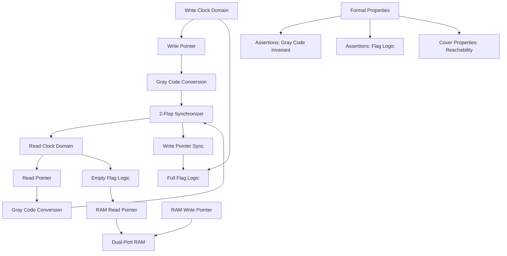
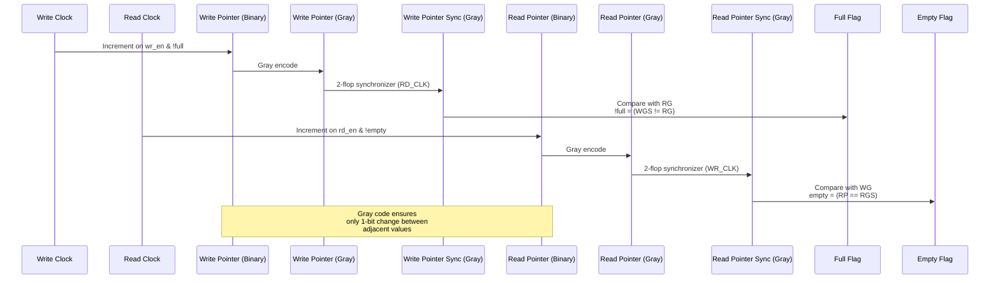

# Async FIFO Formal Verification

## Project Overview & Architecture

This project provides formal verification of a Gray-code CDC (Clock Domain Crossing) Asynchronous FIFO buffer using Yosys, SymbiYosys, and Z3. The core purpose is to mathematically prove the correctness of the FIFO design across asynchronous clock domains, ensuring properties like overflow/underflow prevention, pointer stability, and correct flag behavior under all possible timing scenarios.

Formal verification is used instead of simulation because it exhaustively checks all possible state transitions and timing interleavings, catching corner-case bugs that simulation might miss due to limited test scenarios. This is particularly important for CDC designs where metastability and synchronization issues can occur rarely but catastrophically.

[Async FIFO Formal Verification Project Diagram](https://github.com/kartik-2311/async-fifo-formal-verification)

## Architecture & Workflow



## Visual Workflow: Dual-Clock Domain Interaction



## Features & Verification Scope

The following properties are formally verified:

- **Gray-code one-bit-change invariant**: Both write and read pointers maintain Gray code properties ensuring safe CDC
- **Reset behavior**: 
  - `wr_full` deasserted on first cycle after write reset release
  - `rd_empty` asserted on first cycle after read reset release
- **Flag logic correctness**:
  - `wr_full` exactly matches Gray-code comparison formula
  - `rd_empty` exactly matches Gray-code comparison formula
- **Metastability hardening**: 2-flop synchronizers prevent metastability propagation
- **Coverage properties**:
  - Full condition is reachable from empty state
  - Recovery from full condition is possible
  - Empty condition is reachable after data has flowed through
- **Pointer stability**: Address pointers remain within valid bounds

## Quick Start & Prerequisites

### Required Tools
- [Yosys](https://github.com/YosysHQ/yosys) with [yosys-slang](https://github.com/YosysHQ/yosys-slang) frontend
- [SymbiYosys](https://github.com/YosysHQ/SymbiYosys) for formal verification management
- [Z3](https://github.com/Z3Prover/z3) SMT solver (or alternative supported by SymbiYosys)
- Standard Unix toolchain (make, bash, etc.)

### Installation
```bash
# Install Yosys with slang plugin
git clone --recursive https://github.com/YosysHQ/yosys
cd yosys
make config-clang
make -j$(nproc)
sudo make install

# Install SymbiYosys
git clone https://github.com/YosysHQ/SymbiYosys
cd SymbiYosys
sudo make install

# Install Z3 (Ubuntu/Debian)
sudo apt-get install z3 z3-dev
# Or build from source: https://github.com/Z3Prover/z3
```

### Running Formal Verification
```bash
# Clone this repository
git clone https://github.com/kartik-2311/async-fifo-formal-verification
cd async-fifo-formal-verification

# Run Bounded Model Checking (depth 30)
sby -f async_fifo_multiclock.sby bmc

# Run Proof (depth 30, induction)
sby -f async_fifo_multiclock.sby prove

# Run Coverage Analysis (depth 30)
sby -f async_fifo_multiclock.sby cover

# Run all tasks (bmc, prove, cover)
sby -f async_fifo_multiclock.sby
```

### Verification Scripts
The project includes helper scripts for streamlined verification:
- `./driver.sh` - Automated task runner for verification workflow
- `./run_quiet.sh NAME -- <command>` - Runs commands with full logging to disk
- `./checks/T00_verify_c03.sh` - Verifies specific fixes and properties

## Project Structure
```
.
├── async_fifo.sv                 # Main FIFO RTL implementation
├── async_fifo_formal.sv          # Formal properties and assertions
├── async_fifo_multiclock.sby     # SymbiYosys configuration for multiclock verification
├── .gitignore                    # Excludes simulation and build artifacts
├── run_quiet.sh                  # Wrapper for running verification commands
├── driver.sh                     # Automated verification task runner
├── checks/                       # Verification check scripts
│   ├── T00_verify_c03.sh         # Claims verification
│   └── T08_cleanup.sh            # Cleanup utilities
├── triage/                       # Address-specific verification scratch
├── phase_2_and_3/                # Advanced verification configurations
├── results/                      # Verification outputs and evidence
└── mutants/                      # Mutation testing configurations
```

## Notes on Verification Approach
- Uses sticky reset history technique to properly handle asynchronous resets in formal verification
- Immediate assertions in SystemVerilog for compatibility with yosys-slang synthesis path
- Properties cover both safety (assertions) and liveness (cover) aspects
- Multiclock mode enabled to verify with truly independent asynchronous clocks
- Depth of 30 chosen to capture deep FIFO behaviors while keeping verification tractable

---
*Formal verification proves correctness where simulation can only show absence of bugs in tested scenarios.*