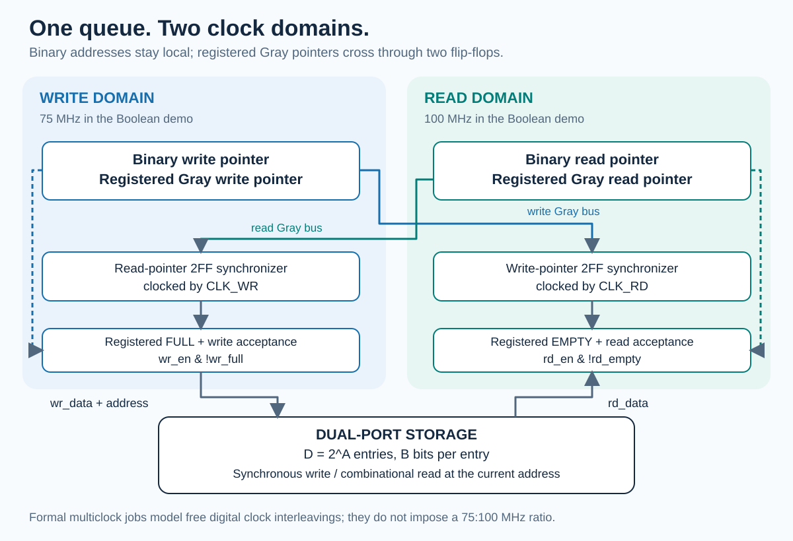
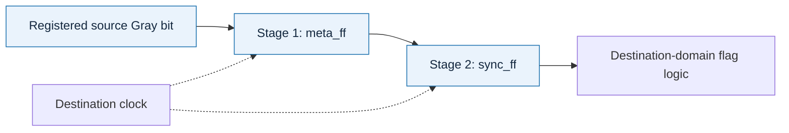
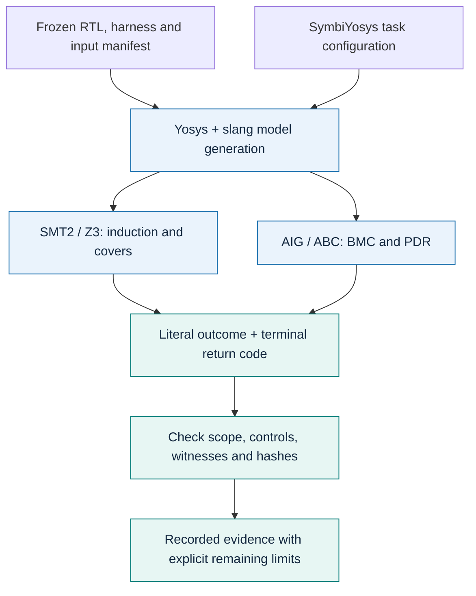
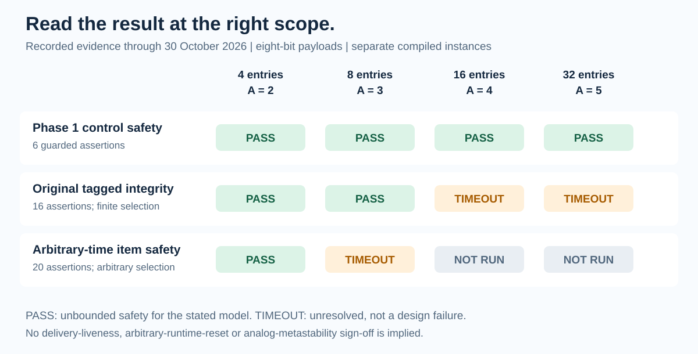
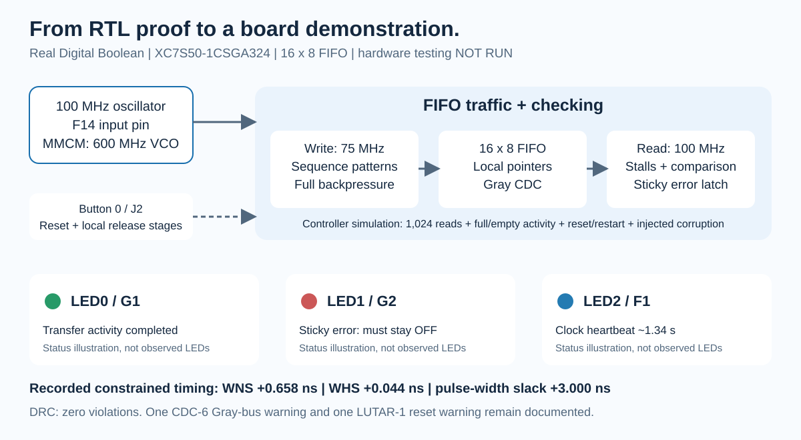

# Async FIFO formal verification

**Gray-pointer dual-clock FIFO · Open-source formal checks · Spartan-7 demonstration**

This project combines reproducible digital safety proofs, transaction-integrity checking, mutation experiments and a buildable FPGA demonstration. The core is a parameterized asynchronous FIFO with local binary/Gray pointers, two-stage pointer synchronizers and conservative full/empty flags.

The results are **configuration-specific**: each conclusion belongs to a checker, clock/reset model and data width. Wider-proof timeouts remain explicit. A generated FPGA image and a formal RTL theorem are separate pieces of evidence.



*75/100 MHz describes the Boolean FPGA demonstration. Independent-clock formal jobs allow free digital clock interleavings.*

## Contents

- [Start here](#start-here)
- [Architecture and interfaces](#architecture-and-interfaces)
- [Pointer mathematics](#pointer-mathematics)
- [Verification workflow](#verification-workflow)
- [Recorded proof status](#recorded-proof-status)
- [Assertions and nonvacuity](#assertions-and-nonvacuity)
- [Mutation detection](#mutation-detection)
- [Run the formal suites](#run-the-formal-suites)
- [Boolean FPGA demonstration](#boolean-fpga-demonstration)
- [Repository map](#repository-map)
- [Troubleshooting](#troubleshooting)
- [Remaining work and integration](#remaining-work-and-integration)

## Start here

| Your goal | First action | Tools needed |
|---|---|---|
| Understand the design | Read the architecture and proof-status diagrams | None |
| Check the verification runner | `python3 tools/test_run_all.py` | Python 3, Bash and standard Linux utilities |
| Simulate the FIFO demonstration | `bash tools/test_sim.sh` | Icarus Verilog and `vvp` |
| Run bounded formal checks | `bash run_all.sh` | Yosys/slang, SBY, Z3 and ABC |
| Reproduce a selected PDR theorem | `python3 tools/run_extensions.py …` | Same formal toolchain |
| Build the Boolean board image | Run the board Tcl script | Vivado and the confirmed Boolean profile |

Clone using your GitHub access, then run the quick checks in **native Linux/WSL**:

```bash
git clone https://github.com/kartik-2311/async-fifo-formal-verification.git
cd async-fifo-formal-verification

python3 tools/test_run_all.py
bash tools/test_sim.sh
bash run_all.sh --check
```

The 16 runner/controller tests exercise status/exit-code agreement, timeout/unknown handling, preservation of result directories, control-failure gating and correct scope labels for optional covers. The driver self-check is a fast software check; it is not itself a formal proof.

The controller simulation checks an initial 1,024-read sweep, full/empty activity, repeated memory wraps, shared reset/restart and detection of deliberately corrupted data. Its output goes to a uniquely named ignored directory under `results/`.

## Architecture and interfaces

### Parameters and storage

| Parameter | Meaning | Examined configurations |
|---|---|---|
| `DATA_WIDTH` / `B` | Bits per word | Recorded FIFO proof rows use `B = 8` |
| `ADDR_WIDTH` / `A` | Address bits | `A = 2, 3, 4, 5` |
| `DEPTH` / `D` | Capacity | `D = 2^A`: 4, 8, 16 or 32 entries |
| Pointer width | Address plus wrap information | `A + 1` bits |

The memory has a **synchronous write port and a combinational read port**. `rd_clk` advances the read address; the core does not add a clocked read-data output register. The full-comparison slice requires `A >= 2`; untested parameter values are not automatically covered by the recorded results.

### Signals and acceptance

| Signal group | Domain | Purpose |
|---|---|---|
| `wr_clk`, `wr_rst_n` | Write | Clock and active-low asynchronous reset |
| `wr_en`, `wr_data[B-1:0]` | Write | Request and payload |
| `wr_full` | Write | Registered status that blocks write acceptance |
| `rd_clk`, `rd_rst_n` | Read | Clock and active-low asynchronous reset |
| `rd_en` | Read | Request to consume the current item |
| `rd_data[B-1:0]` | Read-address path | Combinational data at the current read address |
| `rd_empty` | Read | Registered status that blocks read acceptance |

```text
accepted_write = wr_en && !wr_full
accepted_read  = rd_en && !rd_empty
```

Requests while full or empty are legal backpressure cases. The corresponding operation is rejected, and its pointer does not advance. An unconditional assertion such as `!(wr_full && wr_en)` would incorrectly forbid that input behavior. The integrity harness instead checks accepted transfers against independently tracked occupancy.

### Pointer crossings

1. **Write Gray → read domain → empty comparison.**
2. **Read Gray → write domain → full comparison.**



Both destination stages must remain recognizable to implementation/CDC tools. The first stage is an intentional CDC capture. Digital formal registers do not model analog metastability, and two flops alone do not establish bus coherency or a device-specific MTBF. Source encoding and physical delay/skew constraints matter together.

## Pointer mathematics

An accepted operation advances the local binary pointer modulo `2D`; its low `A` bits address storage:

```text
w_bin_next   = (w_bin + accepted_write) mod (2D)
r_bin_next   = (r_bin + accepted_read)  mod (2D)
gray(binary) = binary XOR (binary >> 1)
```

Let `w_gray_sync` be the second-stage write pointer in the read domain, and `r_gray_sync` the second-stage read pointer in the write domain:

```text
empty_next = (r_gray_next == w_gray_sync)

full_next  = (w_gray_next == {
    !r_gray_sync[A],
    !r_gray_sync[A-1],
     r_gray_sync[A-2:0]
})
```

The upper **two** synchronized Gray bits are inverted for the full comparison. Flags are registered using pre-edge remote samples and next local pointers; the checker uses appropriately tracked history. Remote progress arrives through synchronizer stages, so flag deassertion may be conservative. A fixed two-cycle flag-latency guarantee is not claimed.

Gray one-bit-or-zero change is a **source-domain** property. A destination may skip source states: `00 → 01 → 11` at the source can appear as `00 → 11` at a slower destination without an encoding defect.

## Verification workflow



The compiled checker uses immediate SystemVerilog `assert` and `cover` statements. The recorded frontend path did not support all concurrent SVA/history constructs used during initial development, so history is tracked explicitly.

| Task | A successful result establishes | It does not establish |
|---|---|---|
| BMC | No counterexample within the configured bound | Safety beyond that bound |
| Z3 induction | The stated safety invariant when base and induction checks succeed | Analog behavior or a different environment |
| ABC PDR | Unbounded safety for the retained assertion suite | A minimal induction depth, liveness or all parameter values |
| Cover | Existence of a path to a goal | Safety or progress on every path |
| Mutation check | Detection of the selected defect by that suite | Coverage of all possible defects |

`aigsmt z3` reconstructs AIG counterexamples; it does not mean ABC PDR was solved by Z3. A solver step in a lowered multiclock model is not automatically a write cycle, read cycle or nanosecond.

## Recorded proof status



*Recorded evidence through 30 October 2026, not a live CI badge. Every FIFO row uses eight-bit data. Full engine/model details are in [the verification record](docs/verification.md).*

| Suite | Recorded result | Required qualification |
|---|---|---|
| Six Phase 1 assertions, `A=2–5` | Independent-clock PDR PASS; single-clock Z3 induction PASS | Reset/history-qualified assertions |
| Original integrity, `A=2,3` | PDR PASS, all 16 assertions | Startup tag spans two memory laps; shared startup reset |
| Arbitrary-time observer, `A=2` | PDR PASS; identical-input replay PASS | 20 assertions; selected-item safety, not eventual delivery |
| Arbitrary-time observer, `A=3` | TIMEOUT at 300 seconds | No completed wider theorem |
| Original integrity, `A=4,5` | TIMEOUT at 240 seconds each | Historical `A=4` depth-76 BMC timeout also retained |
| Reset synchronizer reference | PDR PASS, five digital assertions | Reference block, not full runtime FIFO reset/flush behavior |
| Boolean demo, `A=4` | Image generated; timing/DRC checks passed | Physical operation NOT RUN; warnings retained |

The earlier source release reproduced **104 selected outcomes**: 83 PASS, 20 intended mutation/canary FAIL and one TIMEOUT. A follow-up recorded 20 attempts: 9 PASS, 6 FAIL and 5 TIMEOUT. The datasets overlap and include diagnostics/replays; their sum is **not** a count of independent proofs. An expected mutant failure is **not** a failing control design.

## Assertions and nonvacuity

| Checker | Assertions / covers | Main obligations |
|---|---|---|
| Phase 1 | 6 / 3 | Source Gray transitions, local flag equations and first-active reset state |
| Branch diagnostic | 6 / 7 | Same assertions plus first-active and normal-history branch covers |
| Original integrity | 16 / 3 | Accepted-transfer occupancy, pointer agreement, pending-tag memory/data and reset consistency |
| Dedicated CDC | 2 / 2 | One-bit-or-zero changes at each crossing's source |
| Arbitrary-time extension | 20 / 5 total | All old checks plus pending rank, no overwrite, memory retention and selected-read equality |
| Reset reference | 5 / 2 | Async assertion and two-local-edge release, including a later reset/release epoch |

The retained sources contain no `assume` statements. Structural reset generation, initialized monitor state and clock configuration still restrict the environment. Phase 1 uses free local resets with explicit history guards. Integrity/CDC uses one startup reset that is never reasserted. The reset reference is separate from a complete system reset contract.

### Why two integrity checkers?

The original checker freezes one startup tag in an `A+1`-bit sequence space. Its proof is unbounded in time but retains a finite item-selection window.

The additive observer can select **any accepted write at any time**, including after many wraps. It freezes that item's pointer/data, checks its bounded position before the next read, forbids overwrite while pending and checks the selected read's data. All 16 original assertions remain instantiated. This removes the initial-selection-window limitation at the proved four-entry instance.

It does not require a stalled consumer to resume. With no fairness or clock-progress restriction, the environment can keep `rd_en` low forever. The project therefore claims selected-item **safety**, not eventual-delivery **liveness**.

### Reachability needs context

Initialized full-occupancy covers require both domains to complete reset and the independent occupancy monitor to equal capacity. They reach at steps 9 and 17 for `A=2` and `A=3`. The late-selection consumption witness reaches at step 23 under concrete equal-clock traffic.

A shallow historical full-flag cover under permissive initial/reset state was not evidence that an initialized 32-entry FIFO had filled. This motivated separate initialized-occupancy coverage. A cover's scope and reset context matter as much as its PASS label.

## Mutation detection

Selected four-entry BMC matrix: Phase 1 independent-clock depth 30; integrity/CDC depth 28. A mutant PASS means **non-detection by that suite**.

| Design | Phase 1 | Integrity | Source CDC encoding |
|---|---|---|---|
| Unmodified control | PASS | PASS | PASS |
| M1: remove full guard | PASS | FAIL | PASS |
| M2: remove empty guard | PASS | FAIL | PASS |
| M3: shift write address | PASS | FAIL | PASS |
| M4: alter full comparison | FAIL | FAIL | PASS |
| M5b: cross binary pointers | PASS | PASS | FAIL |

M1–M4 are also detected in the recorded eight-entry integrity tests with a passing control. Invalid stored M5 is excluded; M5b is its valid replacement, and M5b_rd2wr is a directional diagnostic. Ideal zero-delay data checking can miss an encoding-discipline violation, so dedicated CDC checks remain necessary.

## Run the formal suites

### Toolchain

Use native Linux/WSL with Yosys and slang, SymbiYosys (`sby`), Z3 and `yosys-abc` on PATH. Recorded versions were Yosys 0.69+20, SBY v0.69, Z3 4.13.3 and ABC 1.01; the frontend binary identity is captured with runs. Drivers install nothing and perform no network downloads.

```bash
uname -o
yosys -V
sby --version
z3 --version
yosys-abc -c version
```

### Bounded core

Choose **one** command in a fresh checkout:

```bash
bash run_all.sh                 # declared 98-job bounded core
bash run_all.sh --stretch       # core + width-two Phase 1 PDR attempt
```

The matrix includes clock-model canaries, controls, named mutants, Phase 1 single/independent-clock checks, bounded integrity/CDC checks, reset-branch covers and initialized occupancy covers. Single-clock and `multiclock on` results are labeled separately.

### Selected extensions

Each command has its own output directory and explicit budget:

```bash
# Qualified control assertions, selected parameter instance.
python3 tools/run_extensions.py phase1-pdr --width 5 --timeout 120

# Original finite-tag integrity; larger budget at width three.
python3 tools/run_extensions.py integrity-pdr --width 3 --timeout 600

# Arbitrary-time selected-item safety, four-entry instance.
python3 tools/run_extensions.py observer --width 2 --timeout 300

# Equal-clock reachability witness, not unbounded safety.
python3 tools/run_extensions.py observer-cover --width 2 --timeout 120

# Separate digital reset-release reference.
python3 tools/run_extensions.py reset --timeout 120
```

An extension returns nonzero unless its literal outcome is PASS. TIMEOUT remains unresolved. Increasing the budget creates another experiment; it does not relabel the original result.

### Reading local evidence

`SOURCE_MANIFEST.json` checks release-input bytes before formal execution. Ignored output under `results/` includes:

| Artifact | What it records |
|---|---|
| `results.csv`, `progress.json` | Task, outcome, model, width, bound, engine and scope |
| `case.sby` and source copies | Exact solver configuration and inputs |
| `run.log`, `run.status`, `command.json` | Terminal outcome, code, time and command |
| `versions.json` | Toolchain and frontend identity |
| Witness traces | Assertion failure or reached-cover explanation |

Existing result directories are never overwritten. Use a fresh checkout for a repeat. Source/model identities and literal outcomes matter more than a launcher printing that it finished.

## Boolean FPGA demonstration



*A functional illustration, not a photograph or observed LEDs. Numerical margins are from the recorded 30 October build.*

Target: **Real Digital Boolean**, `xc7s50csga324-1`. Read the [board guide](fpga/boolean/README.md) and [official constraints](https://www.realdigital.org/downloads/8d5c167add28c014173edcf51db78bb9.txt).

| Connection | Pin | Meaning |
|---|---|---|
| Oscillator | F14 | 100 MHz input |
| Button 0 | J2 | Reset/restart |
| LED0 | G1 | Sticky indication of 1,024 completed reads and full/empty activity |
| LED1 | G2 | Sticky mismatch/watchdog error; must remain off |
| LED2 | F1 | Heartbeat, about 1.34 seconds per full cycle |

A 600 MHz MMCM VCO generates buffered 75/100 MHz outputs. Reset assertion combines the button and loss of lock; two-stage chains release reset locally. Read-data comparison is pipelined by one read-clock cycle. PASS may remain lit after a later failure: **always treat LED1 as the failure indication**.

### Build and inspect

With Vivado on PATH, run from the repository root:

```text
vivado -mode batch -nojournal -source fpga/boolean/build.tcl
```

The script resolves source paths, writes ignored `results/boolean/`, refuses to overwrite a prior build, and checks timing/internal clock coverage/DRC before generating `boolean_fifo_top.bit`. Generated `.bit`, `.dcp` and reports are not versioned.

| Recorded implementation check | 30 October result |
|---|---|
| Setup WNS | +0.658 ns |
| Hold WHS | +0.044 ns |
| Pulse-width slack | +3.000 ns |
| DRC violations | 0 |
| Unconstrained internal endpoints | 0 |
| CDC review | One retained CDC-6 Gray-bus warning |
| Reset methodology | One retained LUTAR-1 warning |
| Physical board operation | NOT RUN |

First-stage Gray paths have 10 ns datapath-only/skew bounds and five-endpoint checks per direction. Ordinary RAM/logic and second stages remain normally timed. No broad inter-clock false path is introduced. Review timing, CDC, skew, methodology and DRC together; zero DRC violations do not erase CDC/reset warnings or establish analog reliability.

### Optional volatile programming

With the actual Boolean board connected: **Vivado Hardware Manager → Open Target → Auto Connect**, select the XC7S50, then **Program Device** with the generated `.bit`. Observe heartbeat, PASS, absence of FAIL and reset/restart. No build command automatically programs the device or flash.

## Repository map

```text
.
├── async_fifo.sv                    Canonical unchanged FIFO core
├── rtl/async_fifo.sv                Existing integration path; same logic
├── async_fifo_formal.sv             Compatibility checker copy
├── verification/
│   ├── async_fifo_formal.sv         Six qualified control assertions
│   ├── branch_checker.sv            Branch reachability diagnostics
│   ├── late_observer.sv             Arbitrary-time item observer
│   ├── late_cover_driver.sv         Legal-traffic witness
│   ├── reset_sync_reference.sv      Reset-release reference
│   └── clock_canary.sv              Clock-model diagnostic
├── mutants/                        Named intentional defect variants
│   └── control/                    Original integrity checker
├── tools/                          Runners, regressions, VCD helper
├── fpga/boolean/                   Board wrapper, tests, Tcl and XDC
├── docs/
│   ├── verification.md             Detailed recorded scope
│   └── images/                     Original SVG diagrams
├── run_all.sh                      Native-Linux core entry point
├── run_quiet.sh                    Full local logs, short console output
└── SOURCE_MANIFEST.json             Release-input byte identities
```

The canonical proof source is `async_fifo.sv`. Existing `rtl/async_fifo.sv` differs only in line endings. The root checker is a compatibility copy of the validated checker under `verification/`.

## Troubleshooting

| Observation | Interpretation / next action |
|---|---|
| TIMEOUT | Budget ended without a completed result. Keep it unresolved; inspect configuration and status. |
| UNKNOWN / infrastructure error | No safety conclusion. Diagnose the environment and preserve evidence. |
| Deliberate mutant FAIL | Expected detection only with a valid failed assertion/witness and passing control. |
| Unreached cover | Reachability was not established. Check bound, reset model and driver. |
| Source-manifest mismatch | Input bytes changed. Review before regenerating; do not bypass the check. |
| Existing output directory | Prior evidence is protected. Use a fresh checkout. |
| Native-Linux guard aborts | Use WSL's Linux filesystem, not MSYS or `/mnt/...` for the formal core. |
| CDC/reset warnings | Review topology, endpoints and model contract; do not suppress them to claim sign-off. |

Documentation assets are also release inputs. A README update changes the manifest while RTL/checker identities may remain unchanged. The manifest is an integrity record, not a proof certificate.

## Remaining work and integration

- Complete wider integrity proofs: original `A=4,5` and arbitrary-time `A>=3` remain unresolved or unrun as recorded.
- Verify actual runtime reset/flush behavior. Independently resetting one pointer domain does not generally preserve queued data.
- Perform the physical Boolean-board run and retain observed pass/fail, heartbeat and reset behavior.
- Complete application-specific CDC/reset review and device reliability analysis; no analog MTBF is claimed.

An AXI4-Lite wrapper needs separate checks for independent AW/W acceptance and pairing, stable stalled responses, byte enables and actual completion. FIFO occupancy alone is not completion. Verify command, response and completion CDC plus the reset contract; standalone FIFO proofs do not automatically establish bus-protocol correctness.

Only useful source, tests, configurations, manifests and concise documentation belong in commits. Raw solver trees, personal execution history, manuscripts and generated FPGA products remain outside the source tree. Removing current copies does not purge private Git history. See [the verification record](docs/verification.md) for full scope and limitations.
